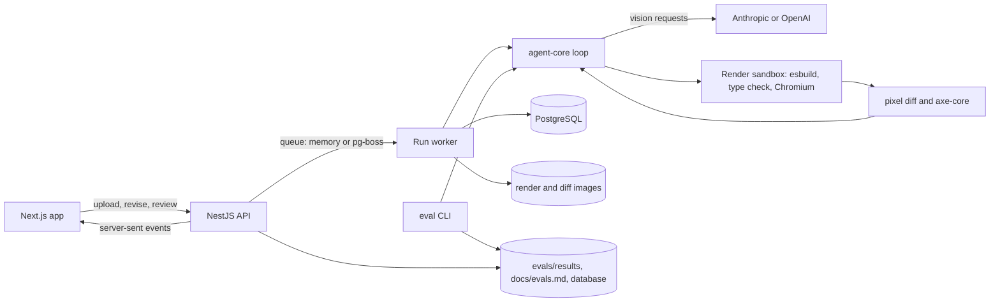

# DesignLoop

[](https://github.com/bjonimerkuri/designloop/actions/workflows/ci.yml)
[](https://github.com/bjonimerkuri/designloop/actions/workflows/codeql.yml)


DesignLoop is an agent that turns a design image into a working **React**, **React with Tailwind CSS** or **Angular** component and checks its own work. It measures the design, builds the component, type-checks it, renders it in a headless browser, compares the render with the design pixel by pixel, runs accessibility checks, and feeds the results back to the model until the component passes or a budget runs out. Every run is stored with its full trace, and an eval suite measures how well the whole system performs.

The point of the project is the engineering around the model: a bounded loop, typed tools, honest measurement, and isolation for running code that a model wrote.

## Contents

- [How it works](#how-it-works)
- [Features](#features)
- [Tech stack](#tech-stack)
- [Quick start](#quick-start)
- [Configuration](#configuration)
- [API](#api)
- [Evals](#evals)
- [Security model](#security-model)
- [Testing and CI](#testing-and-ci)
- [Project structure](#project-structure)
- [Design decisions](#design-decisions)
- [Limitations](#limitations)
- [Roadmap](#roadmap)

## How it works



1. **Measure.** The dominant colors of the design are extracted deterministically from its pixels.
2. **Analyze.** The model describes the design as JSON validated with Zod, using the measured colors. A failed analysis does not stop the run.
3. **Generate.** The model writes the component for the chosen target.
4. **Verify.** The code is checked against an import allow list, type-checked in strict mode, bundled with esbuild, rendered in Chromium at the exact design size with all network requests aborted, compared with the design, and scanned with axe-core. This step can run in a throwaway Docker container.
5. **Decide.** The run stops when it passes, reaches the iteration, cost or time limit, or makes no progress for two passes.
6. **Repair.** Otherwise the model receives its code, the build, type and runtime errors, the largest mismatch regions, the accessibility issues, its own render and a difference image, and writes a revision.

A finished run can be accepted, rejected, or revised with a plain-language note. A revision starts from the current code and is stored as a new run linked to its parent.

## Features

- Bounded agent loop with typed tools, cost, time and iteration budgets, and no-progress detection
- Three output targets: React with CSS, React with Tailwind CSS, and Angular (standalone component, zoneless)
- Pass criteria that combine build, type errors, runtime errors, visual similarity and accessibility
- Strict TypeScript type check of the generated code, static checks that reject APIs a component should never use (`eval`, `fetch`, `innerHTML`, storage and others), and an optional Angular AOT template check
- Measured design colors shown in the UI next to the model's reading of the design
- Live trace of every step over server-sent events, with per-step tokens, cost and duration
- Side-by-side design, render and difference views for every pass
- Revisions that continue from existing code, and accept or reject verdicts on runs
- PNG and JPEG input
- Eval suite with 25 fixture designs, three targets, generated reports, model comparison, regression checks against a baseline, database history and a dashboard page
- Saved runs that replay a real run without any model cost
- Optional per-render Docker sandbox, a durable queue with several workers (pg-boss), run recovery after a restart
- Health, JSON and Prometheus metrics endpoints, structured JSON logs, optional error reporting with Sentry
- Paginated and filterable run list, and a side-by-side comparison of two eval reports in the UI
- Public-demo controls: per-IP hourly limit, daily cost cap and an admin token for metrics
- Light and dark themes

## Tech stack

| Area | Choice | Why |
|---|---|---|
| Language | TypeScript everywhere | One type system from the agent to the UI |
| Agent | Plain TypeScript, no framework | The loop is small and every step is visible and testable |
| Models | Anthropic or OpenAI through a small interface | Switch by configuration, no SDK lock-in |
| Rendering | esbuild, PostCSS with Tailwind v3, Playwright Chromium | A build and render per pass in seconds, offline |
| Checks | TypeScript compiler API, axe-core, pixelmatch | Type errors, accessibility and visual difference |
| API | NestJS, Prisma, PostgreSQL, pg-boss | Structure for a service that stores runs, streams events and scales workers |
| Web | Next.js (App Router) | Server-sent events, replay pages and static saved runs |
| Tests | node:test, Supertest, Jest, Testing Library, Playwright | Unit, API, component and end-to-end coverage |
| CI | GitHub Actions, CodeQL, Dependabot | Build, test, lint, audit, e2e, container builds and static analysis |

## Quick start

Requirements: Node 20 or newer, Docker, and an Anthropic or OpenAI API key with vision support.

```bash
cp .env.example .env
npm install
npm run build:packages
npm run browsers
npm run db:up
npm run db:migrate
npm run dev:api
npm run dev:web
```

Set `ANTHROPIC_API_KEY` or `OPENAI_API_KEY` in `.env`, and set `LLM_PRICE_IN_PER_M` and `LLM_PRICE_OUT_PER_M` to your model's real prices so cost numbers are correct. `prisma migrate dev` asks for a migration name the first time and again after schema changes, and the generated `prisma/migrations` folder should be committed.

Open http://localhost:3000, choose an output, upload a PNG or JPEG between 200x100 and 1600x2000 pixels, and watch the run.

`npm run doctor` checks Node, `.env`, the API key, the database, Chromium, Docker and the build, and tells you what to fix. For a first look without migrations, `npm run db:push` creates the tables directly. To check the agent without the web app, run `npm run eval:fixtures` and then `npm run eval -- --only stat-card`.

### Sandbox

```bash
npm run sandbox:build
SANDBOX=docker npm run dev:api
```

Run the API on the host for this mode. Each verification pass starts a container with no network, a read-only filesystem and resource limits.

### Several workers

```bash
QUEUE=pgboss WORKER_ENABLED=false npm run dev:api
QUEUE=pgboss npm run dev:api
```

The first process only enqueues. Start as many workers as you need with the second command on other ports.

## Configuration

| Variable | Default | Purpose |
|---|---|---|
| `DATABASE_URL` | local Postgres from `docker-compose.yml` | Prisma connection |
| `LLM_PROVIDER` | `anthropic` if its key is set, else `openai` | Model provider |
| `ANTHROPIC_API_KEY`, `ANTHROPIC_MODEL` | none, `claude-sonnet-5-5` | Anthropic access and model |
| `OPENAI_API_KEY`, `OPENAI_MODEL` | none, `gpt-4o` | OpenAI access and model |
| `OPENAI_BASE_URL`, `OPENAI_MAX_TOKENS_PARAM` | OpenAI's API, `max_completion_tokens` | Point the OpenAI client at any OpenAI-compatible server and set the name of its token limit field |
| `LLM_PRICE_IN_PER_M`, `LLM_PRICE_OUT_PER_M` | `3`, `15` | USD per million tokens, used for cost tracking |
| `LLM_RETRIES`, `LLM_RETRY_BASE_MS` | `3`, `2000` | Retries with backoff on rate limits (429) and overload (503) |
| `AGENT_MAX_ITERATIONS` | `5` | Passes per run |
| `AGENT_MAX_COST_USD` | `0.5` | Cost budget per run |
| `AGENT_MAX_SECONDS` | `240` | Time budget per run |
| `SIMILARITY_THRESHOLD` | `0.9` | Visual similarity needed to pass |
| `A11Y_MAX_BLOCKING` | `0` | Serious or critical axe issues allowed |
| `TYPECHECK` | `on` | Set `off` to skip the type check |
| `ANGULAR_AOT` | `false` | Adds an Angular AOT template check (needs `@angular/compiler-cli`) |
| `SANDBOX`, `SANDBOX_IMAGE` | `off`, `designloop-sandbox` | Run verification in Docker |
| `SANDBOX_MEMORY`, `SANDBOX_CPUS`, `SANDBOX_TIMEOUT_MS` | `1g`, `1`, `90000` | Sandbox limits |
| `QUEUE` | `memory` | `pgboss` for a durable queue with several workers |
| `WORKER_ENABLED` | `true` | Set `false` to run an API that only enqueues |
| `API_PORT`, `WEB_ORIGIN` | `4000`, `http://localhost:3000` | API port and allowed web origin |
| `NEXT_PUBLIC_API_URL` | `http://localhost:4000` | API address used by the web app (set in `apps/web/.env`) |
| `DEMO_MODE` | `false` | Enables the per-IP hourly limit and a default daily cost cap |
| `RATE_LIMIT_PER_HOUR` | `5` | Runs per IP per hour in demo mode |
| `DAILY_COST_CAP_USD` | `0` (off), `5` in demo mode | Total daily spend for live runs |
| `ADMIN_TOKEN` | empty | Bearer token required by `/metrics` when set |
| `SENTRY_DSN` | empty | Report server errors to Sentry |
| `TRUST_PROXY` | empty | Express `trust proxy` value when behind a reverse proxy |
| `CHROMIUM_NO_SANDBOX` | `false` | Required when running Chromium as root in a container |
| `STORAGE_DIR`, `EVALS_DIR` | `apps/api/storage`, `evals/results` | File locations |

## API

| Method and path | Purpose |
|---|---|
| `POST /runs` | Multipart upload with `design` (PNG or JPEG), optional `hint` and `framework` (`react`, `react-tailwind`, `angular`) |
| `GET /runs` | Newest runs first, with `limit` (1 to 100), `cursor`, and filters `framework`, `status` and `review`. Returns `items` and `nextCursor` |
| `GET /runs/:id` | One run with all steps |
| `POST /runs/:id/revisions` | JSON `{ "instruction": "..." }`, starts a linked run from the current code |
| `POST /runs/:id/review` | JSON `{ "decision": "accepted" \| "rejected" \| "none" }` |
| `GET /runs/:id/events` | Server-sent events: `step` and `done` |
| `GET /runs/:id/files/:name` | `design.png`, `render-N.png` or `diff-N.png` |
| `GET /evals`, `GET /evals/:name` | Eval report summaries and full reports from files |
| `GET /evals/history` | Eval runs stored in the database, oldest first |
| `GET /health` | Service and database status |
| `GET /metrics` | Last 24 hours: runs by status, pass rate, mean cost, time and similarity (admin token) |
| `GET /metrics/prometheus` | The same figures in Prometheus text format (admin token) |

## Evals

```bash
npm run eval:fixtures
npm run eval -- --framework all --repeats 2 --save-db
npm run eval:compare -- <report-a.json> <report-b.json>
```

The 25 fixtures are designs written as HTML in `fixtures/html`, from a stat card to a data table and a timeline, plus one that contains an instruction aimed at the model. The CLI runs the agent on each design for each target, saves raw results to `evals/results`, rewrites [docs/evals.md](docs/evals.md), and powers the Evals page. Options: `--framework react|react-tailwind|angular|both|all`, `--limit N`, `--only id1,id2`, `--repeats N`, `--model NAME`, `--save-db`, `--baseline FILE --max-regression 0.1`, `--min-pass-rate 0.6`.

Reported per target: pass rate, mean and median similarity, passes per run and per success, cost per run and per success, p50 and p95 time, and failures by category (visual mismatch, compile error, type error, runtime error, accessibility, budget, agent error). Failures are kept in the report.

A scheduled workflow runs the full suite nightly when the repository variable `NIGHTLY_EVAL` is `true`, and fails if a pass rate falls more than the allowed margin below `evals/baseline.json`. Copy a good report there to set the baseline.

Results depend on the model, the prompt version and the fonts of the machine that rendered the fixtures, so every report records the model, prompt version and commit. Numbers appear in `docs/evals.md` after you run the suite.

## Using a free or local model

The OpenAI client works with any server that offers an OpenAI-compatible API and accepts images, so a paid key is not required to try the project.

```bash
LLM_PROVIDER=openai
OPENAI_API_KEY=your-google-ai-studio-key
OPENAI_BASE_URL=https://generativelanguage.googleapis.com/v1beta/openai
OPENAI_MODEL=gemini-2.5-flash
OPENAI_MAX_TOKENS_PARAM=max_tokens
LLM_PRICE_IN_PER_M=0
LLM_PRICE_OUT_PER_M=0
```

```bash
LLM_PROVIDER=openai
OPENAI_API_KEY=ollama
OPENAI_BASE_URL=http://localhost:11434/v1
OPENAI_MODEL=a-vision-model-you-pulled
OPENAI_MAX_TOKENS_PARAM=max_tokens
LLM_PRICE_IN_PER_M=0
LLM_PRICE_OUT_PER_M=0
```

Things to know before relying on a free option:

- Free tiers and model names change. Check the provider's current pricing and limits page.
- Free tiers have low request limits, so a full eval run can hit them. Retries with backoff help, but use `--limit` and `--only` for small runs.
- Some free tiers may use what you send to improve the provider's products. Do not upload private designs.
- Weaker models pass fewer designs. Compare models with `npm run eval -- --model NAME` before you publish any numbers.

## Troubleshooting

| Symptom | Likely cause and fix |
|---|---|
| `npm run doctor` reports failures | Follow the hint under each line, it names the command to run |
| `Executable doesn't exist` from Playwright | Run `npm run browsers` |
| `ANTHROPIC_API_KEY is not set` or the run ends in `error` | Add the key to `.env` and restart the API, which reads it once at start |
| `Can't reach database server` | Run `npm run db:up` and wait a few seconds |
| `The table public.Run does not exist` | Run `npm run db:migrate` or `npm run db:push` |
| `Cannot find module '@designloop/shared'` | Run `npm run build:packages` |
| Every run fails on type errors only | Set `TYPECHECK=off` to confirm, then send the first error line so the cause can be fixed |
| Angular runs fail with `rendered nothing` | Look at the console errors in the trace, they come from the Angular compiler in the browser |
| Runs stay `queued` | The API was started with `WORKER_ENABLED=false`, or `QUEUE=pgboss` has no worker process |
| Sandbox runs fail with `docker: command not found` | Run the API on a host with Docker, and run `npm run sandbox:build` first |

## Security model

The threat model, controls and what is not covered are in [SECURITY.md](SECURITY.md). In short: design text is treated as untrusted content, generated code is limited to an import allow list, the renderer blocks the network and can run in a throwaway container, uploads are decoded and re-encoded, and a public instance has rate and cost limits.

## Testing and CI

```bash
npm test
npm run lint
npm run e2e -w @designloop/web
```

- **Agent loop:** tests with a fake model and a fake renderer cover passing on a later pass, no-progress, cost budget, iteration limit, accessibility and type-error blocking, revisions, measured colors and the injection guard in prompts.
- **Checks:** import allow list, remote CSS, Angular component shape, image detection, the type check and color measurement.
- **Reports:** summaries, percentiles, failure categories, markdown, model comparison and regression detection.
- **API:** Supertest against the real controllers with a fake database: validation, size limits, PNG and JPEG upload, file serving, path traversal, revisions, reviews, rate limit, admin token and eval endpoints.
- **Web:** component tests with Jest and Testing Library, and Playwright end-to-end tests for the home page, saved-run replay and theme switch.

GitHub Actions runs lint, build and tests on Node 20 and 22, end-to-end tests, container builds, `npm audit` for production dependencies and CodeQL. Manual and nightly jobs run evals and upload the report. Dependabot keeps dependencies, actions and base images current.

## Project structure

```
packages/shared      types shared by the API, web app and evals
packages/agent-core  agent loop, model clients, render, type check, diff and accessibility tools, sandbox, tests
packages/evals       fixture renderer, eval CLI, reports, comparison, regression check, tests
apps/api             NestJS API, Prisma schema, queue, event stream, tests
apps/web             Next.js interface, component and end-to-end tests
fixtures             manifest and HTML sources of the eval designs
docs                 spec, architecture, decision records, generated reports
```

## Design decisions

Short records with context and consequences are in [docs/decisions](docs/decisions): no agent framework, esbuild and browser JIT for verification, multi-signal pass criteria, run state in PostgreSQL with a pluggable queue, file-based evals, plain CSS with a Tailwind target, npm workspaces instead of Nx, and the Docker sandbox.

## Limitations

- Angular templates are compiled with the JIT compiler in the browser. The TypeScript is fully type-checked, template type errors need the optional AOT check.
- Pixel similarity is coarse. It is combined with build, type, runtime and accessibility checks for that reason.
- The renderer uses system fonts. With the Docker sandbox, fonts inside the image differ from the host, so render eval fixtures with the same setup.
- Without `SANDBOX=docker`, generated code is bundled and rendered in the API's process tree.
- There is no user authentication, only the demo limits and the admin token for metrics.

## Roadmap

- Perceptual similarity metric next to pixel difference
- Lint rules for generated code beyond type checks and axe
- Authentication and per-user history
- Figma frame import
